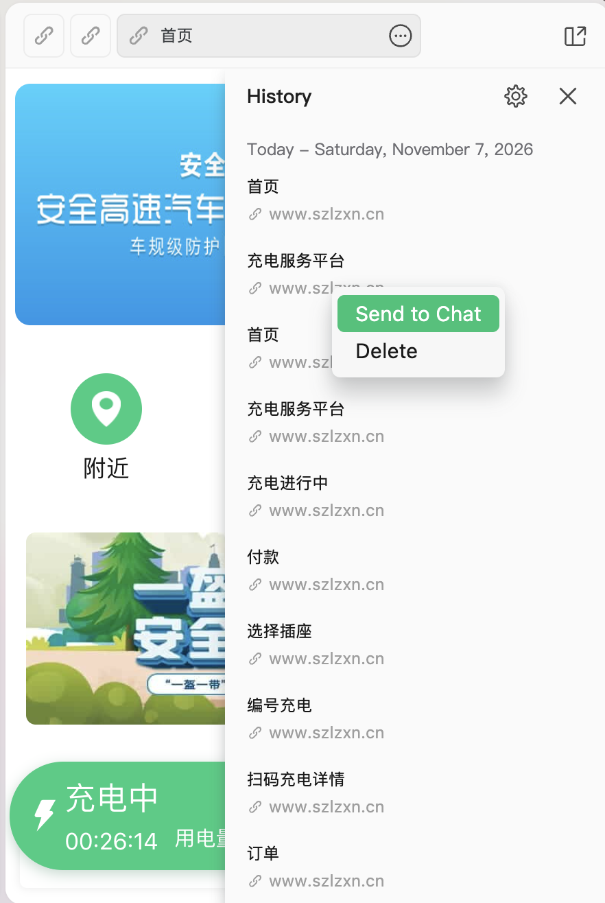
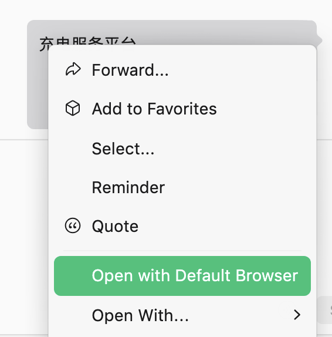

# 浙江大学尼普顿定时开电

单文件工具，让浙大「尼普顿 / 新能充电」（szlzxn.cn）充电桩在指定时间自动开电。零依赖，Node 18+。

协议由作者对本人账号抓包独立还原，代码原创（灵感来自 [ZJU-Charger](https://github.com/ZJU-Charger/ZJU-Charger) 项目）。

## 快速上手

```bash
node neptune.mjs login    # ① 配置向导，一次即可
```

按提示把**充电页链接**粘贴进去（新版微信没有「复制链接」，实测最稳的路径是走电脑微信）：

1. 手机把充电页转发给「文件传输助手」
2. 电脑微信点开 → 打开 H5 窗口的 **History** 面板 → 右键「充电服务平台」条目 → **Send to Chat** → 发回文件传输助手
3. 聊天里**右键这条消息 → Open with Default Browser** → 复制浏览器地址栏

<p align="center">
  &nbsp;&nbsp;
  
</p>

目标链接形如（`openId` 在 `#` 之前，等同支付钥匙，勿外传）：

```
https://www.szlzxn.cn/wx/indexn.html?openId=****&areaid=6&employeeId=****&accountmoney=…#/
```

向导会校验账号、从你的充电记录里选出常用桩和插座、写入本地配置（已被 `.gitignore` 排除）。

## 定时开电

```bash
crontab -e
# 周一到周五 6:30 自动开电（桩工作时间 6:00-24:00）
30 6 * * 1-5 /usr/bin/env node /path/to/neptune.mjs start >> /tmp/neptune.log 2>&1
```

`start` 是幂等的：到点时已有充电订单自动跳过，余额不足拒绝并记入日志。睡前插好充电器即可。

## 其他命令

```bash
node neptune.mjs status   # 余额 / 充电订单 / 端口状态
node neptune.mjs stop     # 结束充电（退款约 30 秒到账）
node neptune.mjs parse    # 从链接解析 openId（只打印不写配置）
```

## 说明

- 扣费为账户预存款（开电预扣约 ¥2，停止/充满后按实际用量结算）。
- 仅供学习交流与**本人账号**自用自动化；勿操作他人设备、勿高频请求；接口为非官方逆向，随时可能变更。
- 也可手动配置：复制 `neptune.config.local.example.json` 为 `neptune.config.local.json` 编辑，或用环境变量 `NPD_OPEN_ID` / `NPD_DEVADDRESS` / `NPD_PORT`。

## License

[MIT](./LICENSE)
